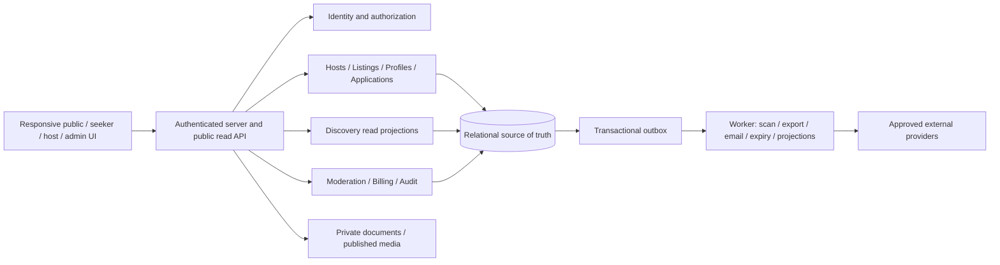

# Explore&Earn V1 — product and scope

Specification version: **1.2 · 2026-11-02**. Status: living V1 vision; confirmed scope plus recommended/inherited contracts and explicitly open decisions. No application is implemented. Audience: product, design, engineering, QA and marketplace operations.

## 1. Product promise and non-negotiable rules

Explore&Earn helps people evaluate both a job and the life arrangement around it: work, destination, timing, compensation, housing, meals and the host. The same opportunity can be discovered through deliberate search, swiping, or geographic exploration.

1. The only top-level categories are **Maritime, Seasonal, Farm, Remote**. Persist `maritime`, `seasonal`, `farm`, `remote`; display the exact title-cased names. Employment type, occupation and work arrangement are independent dimensions, never additional categories.
2. Mobile seeker bottom navigation is pinned and ordered **Seek / Swipe / Map / Profile**. All three discovery modes are first-class destinations, not filters hidden under Seek. Profile contains the private seeker dashboard with cover/headshot-or-avatar, resume, saved/skipped jobs, application pipeline, messages, notifications and settings; detailed grouping is a recommendation.
3. One canonical listing and published revision power every card, detail page, search result and application. Modes do not own separate job records.
4. One identity may own a seeker profile and memberships in multiple host organizations. Workspace switching is explicit. Host navigation is different from seeker navigation.
5. A right swipe saves; it never submits an application. Applications require a review screen and explicit submission.
6. Housing and meals have structured detail sheets with four predefined photo slots each. Unknown information is labeled, never treated as free or unavailable.
7. Host logo and name open the public host storefront. A verified mark represents a defined verification scope, never an employment guarantee.
8. **Confirmed:** seekers are **free forever**. Discovery, native profile, resume building/import/export, applying and seeker community must not require seeker payment. The current business direction is host monthly subscriptions named Starter / Professional / Enterprise; exact prices, listing allowances and optional upsells remain open.

Rules 1–3 and the core of 6–7 reflect confirmed requirements. Dual-role identity (4), exact gesture mappings (5), fixed photo-slot labels and numerical-match deferral are recommended/inherited implementation choices; see [decision status](08-sources-and-decisions.md). The user confirmed four predefined photo fields per sheet, but the final field labels are still a recommendation.

### Living vision and product principles

Build a trusted way to choose a job **and the life around it**. Seekers should understand the work, when it begins, what it pays, where they will stay/eat, and who is hosting before applying. Hosts should present an honest destination/workplace and manage intentional applicants with clear consent.

**Confirmed additions:** persistent native seeker profile with in-app building and reviewed upload/import autofill; availability presets Now / 1 month / 3 months / Beyond and exact date; experience, education, bio, location, granular contact visibility, certifications and highlighted skill badges; seeker community with Feed / Photos / Announcements, reactions and no photo comments; moderated, labeled, limited paid host content; explicit seeker/host onboarding.

**Recommended principles:** no empty-profile wall before browsing; no fabricated qualifications, match percentages or housing claims; progressive details without hiding costs; private professional data separated from social identity; paid visibility cannot purchase trust or fit; preserve seekers' ability to complete all core flows for free. Resume template alternatives, AI optimizer, groups/organizations and final brand copy remain brainstorm decisions.

Illustrative needs, not research findings: a first-season worker comparing included housing; a mariner checking rotation and credential expiry; a farm worker aligning a harvest start with availability; a remote worker checking eligible countries/timezones; a small host publishing one honest job; a multi-site host managing roles and applicants. Validate these with real seekers/hosts before claiming demand.

Brand direction: **“Seekers free forever”** is confirmed positioning. **“Built for seekers, by seekers”** is a proposed tagline, to use only if the team can substantiate it. Creative alternatives for discussion: “Find your next place to work and live” or “Work worth going somewhere for”; the latter needs Remote-inclusive supporting copy. Never imply all jobs include housing or meals.

## 2. V1 boundary

| V1 launch requirements | Later, unless explicitly promoted through a decision |
| --- | --- |
| Responsive web experience; all four categories and all three discovery modes | Native app packages and offline applications |
| Public published listings/storefronts; authenticated save, skip, profile and apply | Public seeker directory, reverse sourcing and talent pools |
| Internal applications and clearly disclosed external apply links | ATS integrations, automatic external status synchronization |
| Structured native profile; manual builder and upload/import with field review; availability; private certification records; variants and PDF export | Optional AI optimizer; automated issuer verification beyond approved manual scope; final template count open |
| Host multi-location storefront, team roles, listings, applicant pipeline and application-linked text messaging | Video interviews, calendar scheduling integrations, payroll, contracts and payments to workers |
| Explainable rules-based fit hints, never automated hiring decisions | AI percentages, candidate scoring, market pay comparison slider |
| Admin verification/reports/takedowns/appeals; seeker Feed/Photos/Announcements with moderation and privacy | Comments, seeker text-post discussions, reviews/ratings and public testimonials pending separate decisions |
| Host monthly Starter / Professional / Enterprise subscription direction; limits/prices open; limited sponsored jobs/employer campaigns, activated only after inventory/moderation/payment gates | Enterprise automation, add-on seats/listings and one-off listings; prices and commercial launch sequence open |
| Optional weather widget that can fail independently | Rich destination intelligence and companion account linking |

**Inherited recommendation, pending D22:** only paid employment and paid contract opportunities are in V1. Volunteer/work-exchange listings and unpaid roles are excluded pending separate product and jurisdiction review. This choice does not imply the four categories are employment classifications. Baseline launch assumptions are English, adult users, a US-only pilot and USD host subscriptions. Listing currency is explicit and need not equal subscription currency, but supported pilot currencies must be configured before publication. These assumptions require business/legal approval before launch, not before documentation or implementation.

## 3. Information architecture

| Surface | Routes (proposed contract) | Primary navigation |
| --- | --- | --- |
| Public/seeker discovery | `/seek`, `/swipe`, `/map`, `/jobs/:id/:slug?`, `/hosts/:slug` | Seek, Swipe, Map, Profile; desktop equivalent top links |
| Seeker workspace | `/profile`, `/profile/edit`, `/profile/resumes`, `/profile/saved`, `/profile/skipped`, `/profile/applications`, `/profile/messages`, `/profile/settings` | Pinned four-tab nav; Profile section links |
| Community | `/community/feed`, `/community/photos`, `/community/announcements`, `/community/photos/:id`, `/community/announcements/:id` | Secondary entry from Seek header and Profile; four pinned tabs unchanged (recommended entry placement) |
| Auth/onboarding | `/welcome`, `/sign-in`, `/sign-up`, `/verify-email`, `/recover`, `/onboarding/seeker`, `/onboarding/host`, `/workspaces` | Explicit “I’m a seeker” / “I’m a host”; validated return destination |
| Host workspace | `/host/:orgId/overview`, `/listings`, `/applicants`, `/messages`, `/storefront`, `/locations`, `/team`, `/analytics`, `/billing`, `/settings` under that prefix | Desktop sidebar; mobile Overview, Listings, Applicants, More; messaging in More and contextual links |
| Admin | `/admin/queue`, `/hosts`, `/users`, `/listings`, `/reports`, `/appeals`, `/billing`, `/taxonomy`, `/audit`, `/settings` under `/admin` | Separate role-limited admin sidebar |

Profile opens sign-in for guests while retaining discovery state. Saved, Applications and Messages are prominent Profile shortcuts with unread counts; they do not replace any discovery tab. Application detail and inbox links may open nested screens. Seeker, host and admin roles never blend into one ambiguous navigation shell. Host routes require membership even if the same user has a seeker account.

Deep links use immutable IDs; slugs are cosmetic for jobs and redirect on change. Host slugs are unique with a redirect history. Browser Back restores previous scroll/deck/map state. Tab selection remains visible beneath discovery sheets, respects device safe areas, and cannot be covered by fixed action bars.

## 4. Architecture decision

Use a **modular monolith**, a responsive frontend, a server application, a relational database with geographic queries, private/public object storage, and a background worker. PostgreSQL with geospatial support is the recommended baseline; framework, auth vendor, maps vendor, billing provider and hosting selection remain implementation decisions in P0. No service/vendor subscription is provisioned by this spec.

Logical module ownership:

| Module | Owns | Allowed dependency |
| --- | --- | --- |
| Identity | Accounts, sessions, memberships, scoped platform roles | No dependency on public search |
| Hosts | Organizations, locations, storefront revisions, team | Identity, media |
| Listings | Drafts, published revisions, requirements, publication lifecycle | Hosts, entitlements, moderation |
| Seekers | Private profile, history, resumes, preferences | Identity, media |
| Discovery | Search projection, mode state, saves/skips, fit explanations | Published listings; private preferences only for requesting seeker |
| Hiring | Applications, snapshots, status history, messages | Listings and seeker snapshot read interfaces |
| Billing | Provider references, plan versions, entitlement ledger | Identity and organization; never applicant content |
| Trust/operations | Verification, reports, sanctions, appeals, audit | Narrow permissioned access to other modules |
| Community | Photo posts, announcement content/revisions, reactions, visibility and feed projections | Identity, media, trust; read-only approved host/listing projections |
| Campaigns | Paid inventory reservations, campaign delivery, disclosure and accounting | Community, billing adapter, trust; no private resume or matching data |
| Import/credentials | Private extraction proposals, review decisions and verification cases | Seekers, private media, scoped trust; never direct public publication |

Modules use shared transactions where necessary, with named domain services rather than direct arbitrary table writes. Database constraints enforce tenant relationships. The database is authoritative for permissions, publication, quotas and submission; cached search is never authoritative. Search may start with database full-text/geographic indexes. Separate search infrastructure is deferred until measured need.

Host/listing images are publicly readable only after explicit publication and scanning; community images additionally require authenticated audience/block checks on every read; resumes, credentials and application attachments are private. All storage buckets remain private: a server media route checks current publication references and purpose-specific audience/authorization before streaming approved derivatives. V1 listing/storefront/discovery HTML and JSON and user-uploaded media use `Cache-Control: no-store`; only static application assets use CDN caching. This makes new requests honor takedowns without waiting for cache expiry. Previously downloaded bytes cannot be recalled. Vendor adapters isolate maps, weather, billing, email and storage. Reviewed import is in scope; AI is not mandatory. Recommend local deterministic extraction first. No resume/profile content goes to an external parser/AI vendor without a documented provider decision, data-handling review and explicit import consent; optional optimizer is a separate open feature. Import text is untrusted data and cannot trigger tools, follow embedded instructions or publish profile changes. Use environment-specific databases, buckets, provider credentials and webhook secrets.

## 5. Launch quality and success measures

These are acceptance targets, not observed performance: at a synthetic dataset of 50,000 published listings, search server p95 <=800 ms and non-upload writes p95 <=1 second at 50 concurrent active users; map preview/list publication visibility within 60 seconds, with authoritative detail/submission checks immediately. Revocation and moderation safety do not wait for cache expiry. Measure mobile page experience on a documented mid-range device/network; target initial usable discovery within 3 seconds with optimized images and lazy map loading. Scope/load assumptions must accompany results.

Operational targets: 99.5% monthly availability for discovery/application endpoints; database restore point <=24 hours and restore time <=8 hours, proven by a pilot restore drill. Alerts cover application errors, worker backlog, moderation backlog, failed webhooks and projection lag. Target WCAG 2.2 AA across core flows; use keyboard, screen-reader, reduced-motion and touch testing, not automated checks alone. See [the W3C standard](https://www.w3.org/TR/WCAG22/) for the baseline.

Measure unique eligible listing views, listing-detail opens, saves, completed internal applications, external apply exits, host first-publication time, median host response time, report/takedown time and retention. Deduplicate impressions per user/session and listing per 30 minutes. External clicks are not applications or hires. Report hiring outcomes as host/seeker reported, with actor and timestamp. Do not optimize raw swipe count at the expense of intentional applications. See [delivery gates](07-delivery-plan.md).

## 6. Latest product refinement — host-first Map and focused dashboards

The user reaffirmed all four verticals (Maritime, Seasonal, Remote, Farm), four seeker tabs, native modern resume builder/import and three community tabs. The latest card field list reaffirms category, cover, logo, verified badge when earned, position/company/location/housing/meals/pay and Skip/Apply/Save; it does not retract prior date/match/detail-sheet requirements. Card variations reuse canonical listing data.

**Directional preference, not a final interaction lock (D25):** the user favors host-logo category pins leading to the public host page with listings. Recommend one pin per host/worksite or home port, tap to that public page's relevant jobs, and Back restoring the map. Optional preview/collapsible map remains an alternative; no fixed percentage is approved. A physical pin never represents where a location-independent Remote job must be performed.

**Current commercial naming/model:** monthly Starter / Professional / Enterprise. Old free-Starter/Growth/Pro prices and quotas are superseded proposals, not defaults. Recommend selling concurrent active listing slots rather than a lifetime total; start with two upsells, Boosted job and Announcement campaign, through one campaign system. Invitation credits and extra capacity packs remain open; no new seeker directory/outreach system is implied.

**Dashboard brainstorm:** seeker cover + headshot/avatar, resume, availability, application progress, Saved, Skipped, Messages, Notifications, Settings; host public-profile editor, listings/capacity, applicants with interview/not-selected/hired views, billing, tier-aware analytics, messages/notifications and settings. Pipeline views filter canonical applications rather than creating independent status collections. See [dashboard details](03-profiles-and-host-workspace.md) and D26–D28.
