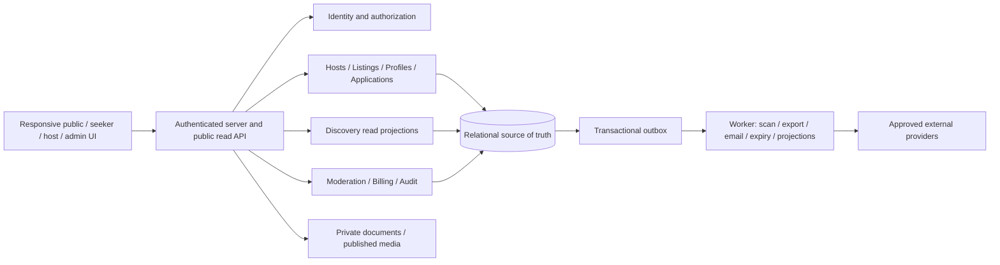

# Explore&Earn V1 — product and scope

Specification version: **1.0 · 2026-11-02**. Status: implementation baseline with explicitly proposed commercial and operational defaults. Audience: product, design, engineering, QA and marketplace operations.

## 1. Product promise and non-negotiable rules

Explore&Earn helps people evaluate both a job and the life arrangement around it: work, destination, timing, compensation, housing, meals and the host. The same opportunity can be discovered through deliberate search, swiping, or geographic exploration.

1. The only top-level categories are **Maritime, Seasonal, Farm, Remote**. Persist `maritime`, `seasonal`, `farm`, `remote`; display the exact title-cased names. Employment type, occupation and work arrangement are independent dimensions, never additional categories.
2. Mobile seeker bottom navigation is pinned and ordered **Seek / Swipe / Map / Profile**. All three discovery modes are first-class destinations, not filters hidden under Seek. Profile contains saved/skipped jobs, applications, messages, resume and settings.
3. One canonical listing and published revision power every card, detail page, search result and application. Modes do not own separate job records.
4. One identity may own a seeker profile and memberships in multiple host organizations. Workspace switching is explicit. Host navigation is different from seeker navigation.
5. A right swipe saves; it never submits an application. Applications require a review screen and explicit submission.
6. Housing and meals have structured detail sheets with four predefined photo slots each. Unknown information is labeled, never treated as free or unavailable.
7. Host logo and name open the public host storefront. A verified mark represents a defined verification scope, never an employment guarantee.
8. Core seeking is free. Prices below are proposals, not commitments from the user or live offers.

## 2. V1 boundary

| V1 launch requirements | Later, unless explicitly promoted through a decision |
| --- | --- |
| Responsive web experience; all four categories and all three discovery modes | Native app packages and offline applications |
| Public published listings/storefronts; authenticated save, skip, profile and apply | Public seeker directory, reverse sourcing and talent pools |
| Internal applications and clearly disclosed external apply links | ATS integrations, automatic external status synchronization |
| Structured seeker history; resume upload and manual structured resume builder; multiple variants and downloadable PDF | AI resume parsing/editing; automatic credential validation |
| Host multi-location storefront, team roles, listings, applicant pipeline and application-linked text messaging | Video interviews, calendar scheduling integrations, payroll, contracts and payments to workers |
| Explainable rules-based fit hints, never automated hiring decisions | AI percentages, candidate scoring, market pay comparison slider |
| Admin verification, reports, takedowns, appeals, audit logs and billing support | Reviews, ratings, social feed, public testimonials without verification |
| Starter, Growth, Pro entitlement architecture; paid checkout only after gates pass | Enterprise automation, promotions, add-on seats/listings and one-off listings |
| Optional weather widget that can fail independently | Rich destination intelligence and companion account linking |

Only paid employment and paid contract opportunities are in V1. Volunteer/work-exchange listings and unpaid roles are excluded pending separate product and jurisdiction review. This choice does not imply the four categories are employment classifications. Baseline launch assumptions are English, adult users, a US-only pilot and USD host subscriptions. Listing currency is explicit and need not equal subscription currency, but supported pilot currencies must be configured before publication. These assumptions require business/legal approval before launch, not before documentation or implementation.

## 3. Information architecture

| Surface | Routes (proposed contract) | Primary navigation |
| --- | --- | --- |
| Public/seeker discovery | `/seek`, `/swipe`, `/map`, `/jobs/:id/:slug?`, `/hosts/:slug` | Seek, Swipe, Map, Profile; desktop equivalent top links |
| Seeker workspace | `/profile`, `/profile/edit`, `/profile/resumes`, `/profile/saved`, `/profile/skipped`, `/profile/applications`, `/profile/messages`, `/profile/settings` | Pinned four-tab nav; Profile section links |
| Auth | `/sign-in`, `/sign-up`, `/verify-email`, `/recover` | Return to validated internal destination |
| Host workspace | `/host/:orgId/overview`, `/listings`, `/applicants`, `/messages`, `/storefront`, `/locations`, `/team`, `/analytics`, `/billing`, `/settings` under that prefix | Desktop sidebar; mobile Overview, Listings, Applicants, More; messaging in More and contextual links |
| Admin | `/admin/queue`, `/hosts`, `/users`, `/listings`, `/reports`, `/appeals`, `/billing`, `/taxonomy`, `/audit`, `/settings` under `/admin` | Separate role-limited admin sidebar |

Profile opens sign-in for guests while retaining discovery state. Saved, Applications and Messages are prominent Profile shortcuts with unread counts; they do not replace any discovery tab. Application detail and inbox links may open nested screens. Seeker, host and admin roles never blend into one ambiguous navigation shell. Host routes require membership even if the same user has a seeker account.

Deep links use immutable IDs; slugs are cosmetic for jobs and redirect on change. Host slugs are unique with a redirect history. Browser Back restores previous scroll/deck/map state. Tab selection remains visible beneath discovery sheets, respects device safe areas, and cannot be covered by fixed action bars.

## 4. Architecture decision

Use a **modular monolith**, a responsive frontend, a server application, a relational database with geographic queries, private/public object storage, and a background worker. PostgreSQL with geospatial support is the recommended baseline; framework, auth vendor, maps vendor, billing provider and hosting selection remain implementation decisions in P0. No service/vendor subscription is provisioned by this spec.

Logical module ownership:

| Module | Owns | Allowed dependency |
| --- | --- | --- |
| Identity | Accounts, sessions, memberships, scoped platform roles | No dependency on public search |
| Hosts | Organizations, locations, storefront revisions, team | Identity, media |
| Listings | Drafts, published revisions, requirements, publication lifecycle | Hosts, entitlements, moderation |
| Seekers | Private profile, history, resumes, preferences | Identity, media |
| Discovery | Search projection, mode state, saves/skips, fit explanations | Published listings; private preferences only for requesting seeker |
| Hiring | Applications, snapshots, status history, messages | Listings and seeker snapshot read interfaces |
| Billing | Provider references, plan versions, entitlement ledger | Identity and organization; never applicant content |
| Trust/operations | Verification, reports, sanctions, appeals, audit | Narrow permissioned access to other modules |

Modules use shared transactions where necessary, with named domain services rather than direct arbitrary table writes. Database constraints enforce tenant relationships. The database is authoritative for permissions, publication, quotas and submission; cached search is never authoritative. Search may start with database full-text/geographic indexes. Separate search infrastructure is deferred until measured need.

Images are publicly readable only after explicit publication and scanning; resumes, credentials and application attachments are private. All storage buckets remain private: a server media route checks current publication references before streaming approved public derivatives. V1 listing/storefront/discovery HTML and JSON and user-uploaded media use `Cache-Control: no-store`; only static application assets use CDN caching. This makes new requests honor takedowns without waiting for cache expiry. Previously downloaded bytes cannot be recalled. Vendor adapters isolate maps, weather, billing, email and storage. No resume/profile content is sent to an AI provider in V1. Use environment-specific databases, buckets, provider credentials and webhook secrets.

## 5. Launch quality and success measures

These are acceptance targets, not observed performance: at a synthetic dataset of 50,000 published listings, search server p95 <=800 ms and non-upload writes p95 <=1 second at 50 concurrent active users; map preview/list publication visibility within 60 seconds, with authoritative detail/submission checks immediately. Revocation and moderation safety do not wait for cache expiry. Measure mobile page experience on a documented mid-range device/network; target initial usable discovery within 3 seconds with optimized images and lazy map loading. Scope/load assumptions must accompany results.

Operational targets: 99.5% monthly availability for discovery/application endpoints; database restore point <=24 hours and restore time <=8 hours, proven by a pilot restore drill. Alerts cover application errors, worker backlog, moderation backlog, failed webhooks and projection lag. Target WCAG 2.2 AA across core flows; use keyboard, screen-reader, reduced-motion and touch testing, not automated checks alone. See [the W3C standard](https://www.w3.org/TR/WCAG22/) for the baseline.

Measure unique eligible listing views, listing-detail opens, saves, completed internal applications, external apply exits, host first-publication time, median host response time, report/takedown time and retention. Deduplicate impressions per user/session and listing per 30 minutes. External clicks are not applications or hires. Report hiring outcomes as host/seeker reported, with actor and timestamp. Do not optimize raw swipe count at the expense of intentional applications. See [delivery gates](07-delivery-plan.md).
