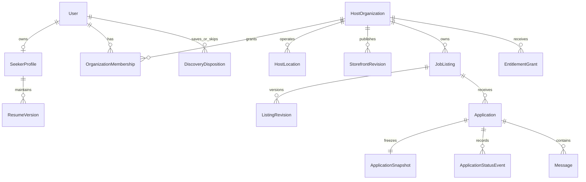

# V1 canonical domain model

This is a logical schema contract, not executable migrations. All IDs are server-generated opaque UUIDs; references are foreign keys. Unless stated otherwise, records have `id`, `created_at`, `updated_at`, integer `version` for optimistic concurrency, and applicable `organization_id` or `user_id`. Timestamps are UTC instants; employment dates are ISO `YYYY-MM-DD` dates plus an IANA workplace timezone. Money is integer minor units plus ISO currency; percentages are decimal basis points or bounded integers as named, never floating currency. Required-at-publish fields can be absent in drafts. Unknown is `null` or an explicit unknown enum, never an empty string, zero or guessed value. Collection sizes/text limits below are server-enforced.

## 1. Entity relationships

`JobListing` is durable identity/lifecycle; `ListingRevision` is complete immutable published content. Mutable draft content is separate. An application references listing identity, published revision, organization, seeker and an immutable snapshot; later edits never rewrite submitted information. `organization_id` is consistent across listing/location/revision/application by constraints, not merely UI checks.

## 2. Listing identity and publication

| Field | Type / constraints | Meaning |
| --- | --- | --- |
| `organization_id` | Required FK | Sole owning host; cannot be reassigned after publication |
| `slug` | <=120 chars | Cosmetic URL label; ID remains authoritative |
| `lifecycle` | `draft`, `pending_review`, `published`, `paused`, `closed`, `expired`, `archived` | Transitions in [workflows](04-workflows-and-api.md) |
| `moderation_state` | `clear`, `review_required`, `restricted` | Independent gate; restricted hides and blocks applications |
| `published_revision_id` | Nullable FK to own revision | Last approved live content |
| `draft_revision`, `draft_base_revision_id` | Versioned draft and source | Prevent lost edits; pending edit never replaces live revision |
| `first_published_at`, `published_at`, `expires_at`, `closed_at` | Nullable instants | Publication cycle; `expires_at` required when live |
| `closure_reason` | `filled`, `canceled`, `host_closed`, `expired`, `moderated`, nullable | Internal reason; safe public label only |
| `created_by`, `last_edited_by` | User FKs | Audit identity |
| `publication_grant_id` | FK | Entitlement consumed by current live/reserved slot |

Public visibility requires lifecycle `published`, current time before expiry, clear moderation, active organization/account, published storefront and approved revision. Paused/closed/expired detail links show a tombstone with safe summary and active alternatives; no Apply. Restricted content exposes only a generic unavailable page. Suspensions cascade through visibility checks without deleting application records.

Default subscription/Starter publication expires in 30 days; republishing requires explicit host review and revalidation, never silent renewal of stale vacancies. Editing content does not reset expiry or freshness. Renewing a reviewed listing can create a new publication cycle on the same ID. Retain immutable publication history; archived IDs cannot be recycled.

## 3. Published listing revision — common fields

Every mode uses these fields. `R` means required to publish, `C` conditional, `O` optional. Arrays default to `[]`.

| Field | Type / cardinality | Rule |
| --- | --- | --- |
| `schema_version`, `revision_number` | Positive integers, R | Revision number unique per listing |
| `title` | Plain text 5–100 chars, R | Position title, no contact information or promotional claims |
| `primary_category` | Four-category enum, R | Exactly one: `maritime`, `seasonal`, `farm`, `remote` |
| `secondary_categories` | Distinct other enum values, max 3, O | Additional relevance; no duplicates; primary determines pin |
| `occupation_code`, `occupation_label` | Curated code + label snapshot, R | Occupation taxonomy is independent of category |
| `summary` | <=300 chars, R | Human-readable card/detail summary |
| `description`, `responsibilities` | Sanitized rich text <=15,000 / <=8,000 chars, R | Allowed formatting only; no executable markup |
| `employment_type` | `employee`, `contractor`, R | No hidden volunteer/work-exchange role |
| `commitment` | `full_time`, `part_time`, `variable`, R | Independent of date/contract type |
| `engagement` | `seasonal`, `temporary`, `permanent`, `project`, R | Farm roles can be seasonal without changing primary category |
| `work_arrangement` | `onsite`, `hybrid`, `remote`, R | Remote primary requires `remote`; other categories may also be remote |
| `location_id` | Own organization location FK, C | Required for onsite/hybrid; listing may have one worksite in V1 |
| `worksite_snapshot` | Location name, city/region, ISO alpha-2 country, timezone and public precision, C | Required with location_id; frozen into revision so later host-location edits cannot move published jobs |
| `location_display` | City/region/country, R | Or explicit remote eligible regions; generated from structured fields |
| `map_anchor` | Public latitude/longitude + precision, C | Frozen from approved location/port at publication; latitude -90..90, longitude -180..180; never private seeker location |
| `remote_eligibility` | See below, C | Required for remote/hybrid |
| `timing` | Object, R | Date contract below |
| `schedule` | Object, R | Weekly hours range 0–168, shift notes <=1,000, rotation optional |
| `compensation` | Object, R | Transparent pay contract below |
| `housing`, `meals` | Objects, R | Explicit arrangements and labeled unknowns |
| `requirements` | Max 30 structured items, R (may be empty) | Item rules below |
| `benefits` | Max 20 `{code, description}` pairs, O | Travel reimbursement, equipment, transport, etc.; no implicit value |
| `application` | Object, R | Internal or external mode, deadline, questions |
| `cover_asset_id` | Approved media FK, O | Listing image overrides host cover; otherwise host cover/neutral placeholder |
| `gallery_asset_ids` | Max 12 approved media FKs, O | Alt text required; organization-owned |
| `category_modules` | Typed module objects, C | Primary module required; modules for relevant secondary categories optional |
| `host_identity_snapshot` | Public name, logo, public location, slug, R | Frozen audit/application context only; discovery uses current approved host name/logo/slug and current verification, while job worksite/terms remain from listing revision |

`remote_eligibility`: `{scope: worldwide|countries|regions, country_codes: [], region_codes: [], timezone_overlap: {iana_zones: [], minimum_hours: 0..24}, onsite_visits: none|occasional, visit_notes}`. Countries/regions required for corresponding scope; worldwide has no contradictory allowlist. Hybrid needs onsite location plus eligibility; “Remote” never implies worldwide. Work authorization/sponsorship notes identify jurisdictions, never citizenship preference.

`timing`: `{start_mode: fixed|asap|rolling|flexible, start_date?, latest_start_date?, end_mode: fixed|ongoing|project, end_date?, duration_notes?, timezone}`. Fixed dates required for fixed modes; latest start >= earliest start; end >= earliest start. Fixed end must also be >= latest start when supplied. Flexible needs a start window or explanatory notes. Past end/deadline cannot publish. `application.deadline_at` is an optional instant and must precede the job end. A deadline earlier than now closes submission even before expiry worker runs.

`requirements[]`: `{id, kind: skill|experience|credential|language|authorization|other, code?, label, required: boolean, minimum_value?, unit?, jurisdiction_codes: [], explanation}`. Labels <=160 chars, explanation <=500. Expiring credentials include validity-at-start requirement. Years experience is nonnegative, with numeric unit `years`; avoid freeform-only hard requirements. Do not ask medical, protected-trait or irrelevant lifestyle screening questions. Required qualifications are disclosed; missing/unknown seeker data can produce a warning, not automated rejection.

## 4. Compensation contract

| Field | Allowed values / validation |
| --- | --- |
| `disclosure` | `range`, `fixed`, `negotiable`; negotiable requires description and pilot policy approval; no silently missing pay |
| `currency` | Required configured ISO currency even for negotiable |
| `basis` | `hour`, `day`, `week`, `month`, `year`, `contract`, `piece`, `catch_share` |
| `minimum_minor`, `maximum_minor` | Integers >=0; fixed has equal values; range has min <= max; negotiable may be null |
| `unit_description` | Required for piece/contract; <=160 chars |
| `share_min_bps`, `share_max_bps` | 0–10,000, min <= max, required for catch share; monetary range nullable when no guarantee |
| `guaranteed_minimum_minor`, `guarantee_period` | Both present or both absent; explain when a share has a guarantee |
| `tips`, `bonus`, `commission`, `overtime` | Each `{status: included|available|not_offered|unknown, notes?}`; no unsupported guaranteed earnings |
| `deductions_notes`, `pay_frequency`, `description` | Required description for variable arrangements; deductions explicit including housing/meals |

Card formatting uses original currency and basis: `$22–$26/hour`, `8–12% catch share · no guaranteed amount`, or `Negotiable · details`. Zero is not a substitute for unknown. Cross-currency/basis pay sorting is disabled; user selects a currency and comparable basis before sorting/filtering amounts. No currency conversion, annualization, share-to-wage inference, or “take-home” estimate in V1. Pay is accessible inline on detail; the comparison slider in the brainstorm is deferred.

## 5. Housing and meals — stable objects, not text badges

`housing` fields:

| Field | Contract |
| --- | --- |
| `availability` | `provided`, `optional`, `not_provided`, `unknown` |
| `cost_status` | `free`, `paid`, `subsidized`, `unknown`, `not_applicable` |
| `cost_minor`, `currency`, `cost_period` | Required together for paid/subsidized: nonnegative money, `night|week|month|season`; free is zero and no implied deposit |
| `deposit_minor`, `deposit_notes` | Nullable; disclose when applicable; same currency |
| `types` | Up to 5: `shared_room`, `private_room`, `dorm`, `cabin`, `house`, `apartment`, `rv_site`, `other` |
| `occupancy`, `description` | Occupancy count nullable >0; description <=2,000 chars |
| `utilities_included`, `pets_allowed`, `couples_allowed`, `transport_provided` | Tri-state `yes|no|unknown`; host policy, not seeker screening filters |
| `distance_meters`, `commute_notes` | Nullable nonnegative distance, notes <=500 |
| `photo_slots` | Exactly four keyed slots: `bedroom`, `bathroom`, `kitchen`, `exterior` |

`meals` fields:

| Field | Contract |
| --- | --- |
| `availability` | `included`, `discounted`, `available`, `not_provided`, `unknown` |
| `cost_status`, `cost_minor`, `currency`, `cost_period` | Same cost semantics; `meal|day|week|month`; discounted/paid offerings require amount or explicitly approved unknown with notes |
| `meals_per_day`, `days_per_week` | Nullable integer 0–6 / 0–7; missing means unknown, not zero |
| `staff_kitchen_access` | `yes|no|unknown` |
| `dietary_notes`, `grocery_access_notes`, `description` | <=1,000 / <=500 / <=2,000 chars; no guaranteed accommodation inferred |
| `photo_slots` | Exactly four keyed slots: `kitchen`, `meal_example`, `dining_area`, `misc` |

Each photo slot is `{asset_id?, state: uploaded|not_available|not_applicable, caption?, alt_text?}`. Uploaded requires a clean approved image and alt text. No duplicate use of the same asset within one set of four slots. Missing images are allowed with a visible “Photo not provided” label; a stock image must not imply actual accommodation. All four slot keys always exist even when no photos. `not_provided` makes cost `not_applicable` and related costs/types empty; photos cannot contradict availability. Free housing or included meals can still have deposits, exclusions or eligibility notes, which must display. Material arrangement changes create a new listing revision.

## 6. Category modules

Module fields with `?` are optional. Required primary modules provide the following minimums; an explicit `unknown` is allowed only where named. Secondary modules obey the same field rules when supplied.

| Category | Structured module | Publish conditions |
| --- | --- | --- |
| Maritime | `vessel_type`, `operation_type`, `home_port_location_id`, `rotation_notes`, `vessel_name?`, `flag_country?`, `operating_region`, `aboard_housing: yes|no|unknown`, `crew_size?` | Vessel/operation type and operating region required; port may be absent only for remote maritime work; credential requirements live in common requirements |
| Seasonal | `season_label`, `season_year`, `season_start`, `season_end`, `destination_type`, `returning_worker_notes?` | Season year integer; start <= end; timing overlaps season; no duplicate contradictory dates |
| Farm | `operation_type`, `production_types[]`, `work_environment: field|greenhouse|livestock|mixed|other`, `equipment_notes?`, `harvest_window?`, `physical_tasks_notes` | Production types nonempty; task description factual and job-related; no medical screening |
| Remote | `role_function`, `collaboration_notes`, `equipment_policy: provided|stipend|self_supplied|unknown`, `internet_requirements?`, `travel_notes?` | `work_arrangement=remote`; eligibility/timezone data in common object; no artificial office-location promise |

Maritime/Farm may be seasonal; Seasonal may be remote. Exactly one primary category controls badges and map marker. Secondary categories are searchable and labeled as secondary. Changing primary category revalidates all required fields and modules. Curated subtype taxonomies may grow without adding top-level categories.

## 7. Application configuration

`application = {mode: internal|external, external_url?, deadline_at?, questions: [], instructions?}`. External URL required only for external, HTTPS only, <=2,048 chars, no credentials in URL. Hosts verify destination domain ownership or receive admin review; redirects are rechecked under URL safety policy. Public link click never includes seeker PII. Internal mode disallows external URL and allows up to 10 questions; external mode has no platform questions. Questions: stable ID, prompt <=300 chars, `short_text|long_text|single_choice|multi_choice|yes_no`, required boolean, choices 2–10 where applicable, max text lengths 500/3,000. No upload or sensitive screening questions in V1. Published question IDs/options are versioned; editing invalidates stale drafts at submission.

## 8. Supporting entities and constraints

| Entity | Key fields / invariants |
| --- | --- |
| `User` | Auth subject unique, verified email, status `active|suspended|deletion_pending|deleted`, display name, locale; auth secrets outside product tables |
| `OrganizationMembership` | Unique `(organization_id,user_id)`, role, status, invitation expiry; exactly >=1 active owner; no self-escalation |
| `HostOrganization` | Legal name private; display name public; slug unique; owner relation, status, verification record, storefront revision pointers |
| `HostLocation` | Organization FK; name, country/region/city, timezone, public coordinate/precision, private street/coordinate; no cross-org references |
| `MediaAsset` | Owner, purpose, storage key, MIME, byte size, hash, scan state, privacy, alt text, publication references; keys server-generated |
| `DiscoveryDisposition` | Unique `(user_id,listing_id)`, state `saved|skipped` or absent, acted_at, source_mode; save and skip mutually exclusive |
| `Application` | Unique `(seeker_user_id,listing_id)` V1; listing/revision/org FKs, state, idempotency key, submitted_at; duplicate API call returns existing record |
| `ApplicationSnapshot` | Selected resume content/PDF reference, selected credential metadata, answers, applicant name/contact, listing revision, disclosure/consent version; immutable except auditable redaction |
| `ApplicationStatusEvent` | Append-only actor, old/new state, reason, time, version; no overwritten history |
| `Message` | Application/thread FK, sender, plain text <=5,000, moderation/deletion marker, created_at; no attachments in V1 |
| `CandidateNote` | Application FK, org FK, author, text <=3,000; host hiring team only; not messaged to seeker |
| `ResumeVersion` | User FK, immutable content/version, source `manual|upload|reviewed_import`, clean asset, label, published_to_application count; see profile spec |
| `Report`, `ModerationAction`, `Appeal` | Reporter private, subject reference, evidence references, reason code, scoped status, assigned reviewer, decision history |
| `AuditEvent` | Actor, capability, target IDs, organization, time, request ID, reason, minimized before/after metadata; append-only restricted access |
| `PlanVersion`, `Subscription`, `EntitlementGrant` | Effective time, provider refs, status, limits, source and expiry; no card data |
| `OrganizationBillingAccount`, `BillingOperation` | Unique billing account per org with current agreement pointer; at most one pending checkout/change operation per org; stable provider idempotency key and operation state |

Indexes: live listing lifecycle/category/location/expiry; geographic public anchor; full-text title/description/occupation; applications `(organization_id,status,submitted_at)` and `(seeker_user_id,submitted_at)`; membership unique pair; disposition unique pair; message application/time; outbox status/retry; audit target/time. Protect reference integrity in the database. Keep structured fields queryable; bounded versioned JSON can hold category modules/snapshots, but not unvalidated arbitrary host metadata.

## 9. Extension ownership

The normalized profile/import/availability/credential/affiliation entities and constraints in [11](11-resume-availability-privacy.md), and content/campaign/reaction entities in [12](12-community-and-campaigns.md), extend this model. They reference the same User, MediaAsset, HostOrganization, JobListing and moderation records. No community post or promotion owns a second copy of a job; campaign creative is revisioned separately and points to the canonical job/host. Shared-content audience checks apply at feed, detail, count, reaction and media endpoints. ApplicationSnapshot includes only reviewed selected native fields/resume version; import staging and social metadata are excluded.

## 10. Example field semantics across categories

| Example (fictional) | Canonical choices | Card display |
| --- | --- | --- |
| Deckhand, coastal vessel | primary Maritime, onsite, home port anchor, fixed season, catch share, aboard housing provided | Maritime · port + operating region · share disclosure · housing/meals terms |
| Lodge cook | primary Seasonal, onsite, fixed start/end, hourly USD range | Seasonal · destination · Begins/Ends · hourly pay |
| Orchard crew | primary Farm, secondary Seasonal, onsite, harvest window, piece basis + explicit guarantee if any | Farm badge; Seasonal secondary in detail · piece-unit disclosure |
| Remote coordinator | primary Remote, remote, US-only eligibility, rolling start, ongoing, monthly pay | Remote · United States eligible · Rolling/Ongoing; no arbitrary destination pin |

None of these are seed listings or approved job terms. Every example must pass the same publication and moderation rules before it could become a real listing.
