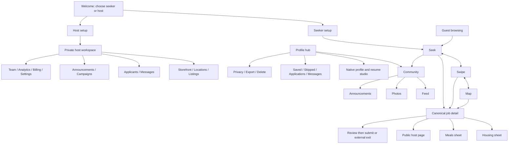

# V1 screen inventory and sitemap

Version 1.1, 2026-11-02. **Confirmed** requirements are identified in [decisions](08-sources-and-decisions.md). Routes, layout, control choices and conditional screens below are **recommended contracts**, not approved visual designs. No app exists yet. This inventory covers complete V1, including operational and failure screens; conditional open features must not be shipped merely because a route is listed.

## 1. Navigation and responsive rules

Mobile seeker navigation is pinned **Seek / Swipe / Map / Profile**, always in that order. Community is recommended as a visible Seek header link plus Profile shortcut, with its own **Feed / Photos / Announcements** subnavigation. It does not add or replace a bottom tab. Desktop has equivalent discovery links and a Profile menu; community may have a secondary header link. Host uses a separate organization sidebar on desktop and **Overview / Listings / Applicants / More** on mobile; More includes messages, storefront, campaigns, locations, team, analytics, billing and settings according to permission. Admin has its own role-limited shell.

Use content-driven breakpoints; recommended review widths are 390px, 768px and 1440px, with 320px/reflow and 200% text checks. Desktop can show list/detail side by side; mobile uses full pages or full-height sheets. A sheet must also have an accessible button alternative to dragging, title, close control, focus management and Back behavior. Avoid nested modal stacks. Pinned nav, keyboard and sticky actions may not cover content or one another. Job/host deep links work without relying on previous screen state. Screen-reader order follows visual reading order.

Every async screen has separate initial loading, empty, retryable error, offline, permission-denied and unavailable states where relevant. Forms preserve unsent changes across recoverable failures, show field-level errors, autosave status and stale-version conflicts; account switching clears private local data. Destructive actions name their consequence and have an explicit confirmation. Public unavailable pages reveal no private moderation reason. No fake jobs/people/photos in real empty states.

## 2. Sitemap

## 3. Public, auth and onboarding screens

| ID / route | Contents and primary actions | Desktop / mobile behavior and acceptance |
| --- | --- | --- |
| P01 `/` | Product promise, four verticals, Browse jobs, “I’m a seeker”, “I’m a host”, seeker-free promise, host pricing link | Responsive hero and job examples explicitly labeled; guest can reach all discovery modes; tagline uses approved copy only |
| P02 `/welcome` | Explicit role choice with short role-specific value; sign-in and continue-browsing | Two equal choice panels / stacked choices; selection is onboarding intent, not irrevocable identity |
| P03 `/sign-up`, `/sign-in` | Auth, terms/privacy links, safe return intent, role context | Single focused form; sign-in cannot auto-submit an application or auto-publish a photo |
| P04 `/verify-email`, `/recover`, `/reset-password` | Verify/resend, recovery and expiry/error states | Generic account-recovery response; recovery returns to pending flow after reauthentication |
| P05 `/onboarding/seeker` | Native name/contact minimum, optional location/category interests, availability, build/import choice, privacy summary; Skip optional setup | Stepper / one step at a time; save/resume; optional fields do not gate browsing; importing always leads to review |
| P06 `/onboarding/host` | Organization create/join invitation, business/public identity, verification context, storefront draft, later listing step | Stepper with draft status; email/legal data private; no automatic paid plan or publication |
| P07 `/workspaces` | Current seeker identity and host memberships; Add seeker role / Create or join host | Menu or dedicated page; explicit org label and permissions; preserve previous seeker tab, clear cross-role private caches |
| P08 `/pricing`, `/help`, `/policies/:slug` | Approved pricing only, contact/report help, privacy/community/terms/refund policies and policy version | Readable responsive content; unapproved $49/$129 hypotheses never shown as live offers; help accessible logged out |

## 4. Discovery, listing and host public screens

| ID / route | Contents and actions | Desktop / mobile behavior and acceptance |
| --- | --- | --- |
| D01 `/seek` | Indeed-like canonical card feed, keyword/location search, filter chips, sort, Community shortcut | Filter rail + feed / pinned search and full-screen filter sheet; Skip/Apply/Save explicit; preserve scroll on Back |
| D02 `/swipe` | Canonical card deck, progress/exhaustion, gesture coaching, Undo, accessible Actions | Centered deck / touch deck; no permanent Apply/Save/Skip footer; keyboard actions available; gestures never submit |
| D03 `/map` | Category legend/pins/clusters, region search, selected card, pull-up viewport list, Remote eligible section | Map/list split / draggable collapsed, preview, half/full list states; button expansion; category icon+text, not color alone |
| D04 discovery filter/sort surface | Pay basis/currency/min, begins within N months, exact range/overlap, category, housing, meals, eligibility, location, reset/apply count | Side panel / sheet; draft filters apply atomically, Cancel restores prior query; incompatible pay sort explains required inputs |
| D05 `/jobs/:id/:slug?` | Cover/logo/host, verification scope, match reasons, category, location, dates, pay/housing/meals, description, requirements, schedule, category fields, host preview; Apply/Save/Skip/Report/Share | Reading column + actions / full page with sticky action above bottom nav; stale/closed/restricted states authoritative |
| D06 housing sheet | Terms, costs/deposit, occupancy, commute/policies; four labeled photo fields | Dialog/panel / bottom-to-full sheet; recommended Bedroom/Bathroom/Kitchen/Exterior; labels still D04 |
| D07 meals sheet | Cost/frequency, kitchen/diet/grocery details, four labeled photo fields | Same pattern; recommended Kitchen/Meal example/Dining area/Misc; unknown/missing images visible |
| D08 photo viewer | One image, alt text, slot/caption, next/previous | Viewer replaces sheet content; Back returns to exact sheet/job; Escape restores focus; no swipe disposition while open |
| D09 `/hosts/:slug` | Facebook-style cover/logo/name/location/weather, active jobs, About, team, featured photos, life on site/FAQ | Hero + anchors + jobs / stacked sections; logo from any card reaches same page; no jobs state; weather failure independent |
| D10 host location detail (section/anchor) | Business locality, jobs at location, labeled approximate map, housing/meals overview | Section / focused section; never exposes private address or vessel live position; listing terms override overview |
| D11 report/share surfaces | Reason, optional evidence, own report receipt; safe public job/host link | Small dialog / sheet; report requires sign-in with return; restricted link never leaks evidence |

Remote remains one of four categories and legend options. Recommended representation is an eligibility list/layer rather than invented physical pins; exact treatment remains D03. A map provider outage leaves the list usable.

## 5. Seeker profile, resume and hiring screens

| ID / route | Contents and actions | Desktop / mobile behavior and acceptance |
| --- | --- | --- |
| S01 `/profile` | Readiness checklist, availability summary, Saved/Skipped/Applications/Messages, Resume studio, edit/privacy, Community, workspace switch | Hub cards / stacked shortcuts above pinned nav; completeness is private and never a hiring score |
| S02 `/profile/edit` | Bio, name/photo, coarse location, contact, experience, education, skills/highlights, credentials, languages, optional affiliations; field audiences | Section sidebar + editor / section list and focused forms; native fields persist independently of resume files |
| S03 `/profile/availability` | Now / 1 month / 3 months / Beyond, exact date, optional latest date/duration, timezone and last confirmed | Show resolved date inline; Beyond asks approximate/date rather than inventing day; past dates need reconfirmation |
| S04 `/profile/resumes` | Native-profile summary, uploaded sources, labeled resume variants, build/import/export/archive actions | Grid/list / stacked cards; scan/render/import states separate; no file implies complete native profile |
| S05 `/profile/resumes/:id/edit` | Section selection/order, summary overrides, contact choices, template preview, refresh-from-profile diff, save version | Editor + preview / edit/preview toggle; old versions/application snapshots immutable; template alternatives conditional D07 |
| S06 `/profile/imports/new` | PDF/DOCX choice, size/processing consent, upload/scan, Cancel | Drop zone and browse / file picker; manual entry always offered; scanner outage leaves pending |
| S07 `/profile/imports/:id/review` | Source beside extracted fields, provenance/warnings, Keep existing/Replace/Add/Ignore and reviewed field decisions | Side-by-side / source/fields switcher; explicit merge summary; no writes to native profile until reviewed merge; conflict re-review |
| S08 `/profile/resumes/:id/preview` | Exact selected resume version, host view and PDF download, field disclosure summary | Document preview / fit-to-width accessible text alternative; structured resume needs successful PDF render. A clean uploaded original may be selected after explicit original-file review when conversion is unsupported/failed; scan failures always block |
| S09 `/profile/credentials/:id` | Issuer/type/date/expiry, private evidence, verification scope/status/history, request/correct/appeal | Detail+timeline / stacked steps; evidence not publicly accessible; automated verification conditional D10 |
| S10 `/profile/optimizer` (conditional) | Optional AI edits shown as before/after with per-edit accept/reject | Never shown until D06/D07 scope/consent resolved; no invented facts, auto-merge or seeker paywall |
| S11 `/profile/privacy` | Field audiences, application preview, social identity/audience, block list, location and download consequences | Audience matrix / per-section controls; privacy change affects future sharing; existing submissions explicitly listed as unchanged snapshots |
| S12 `/profile/saved`, `/profile/skipped` | Canonical cards with current availability; remove/save/restore/apply | List / feed; independent from applications; closed links retain safe history |
| S13 `/jobs/:id/apply` | Select clean resume, native name/contact, selected metadata, required questions, optional letter | Stepper / sequential sections; no account/private preference leak; save recoverable draft |
| S14 `/jobs/:id/apply/review` | Exact resume/document/contact/answers, listing revision and sharing notice; explicit Submit | Review page; stale job revision requires fresh review; embedded PDF contact flagged for user review |
| S15 application receipt | Confirmed ID/time, next actions Track/View host | Receipt derived from server commit; network timeout uses same key, not a second application |
| S16 external exit interstitial | Employer domain, off-platform notice, Continue/Cancel | Responsive dialog/page; click is an external exit, never a claimed submission |
| S17 `/profile/applications` | Internal status vs external activity, filters and safe job summary | Table/list / cards; clearly self-reported outcomes; no combined misleading “Applied” count |
| S18 `/profile/applications/:id` | Submitted snapshot, terms, status timeline, conversation, withdraw/report/block | Detail+timeline / stacked; host internal notes never present; withdrawal does not retract previous downloads |
| S19 `/profile/messages`, `/:applicationId` | Application-linked inbox and thread, unread, text composer/block/report | Inbox+thread / two pages; no unsolicited host directory messaging |
| S20 `/profile/settings` | Email/recovery/sessions, fit opt-in, notification preferences, accessibility, export/delete | Settings sections / focused pages; save independent per section, safe account switching |
| S21 `/profile/data` | Export receipt/progress/download, deletion consequences/request/status, ownership handoff | Reauthentication and transparent retained classes; remove public/social references and restore deletion ledger |
| S22 `/profile/reports`, `/:id` | Own reports/appeals, receipt and high-level outcome | No reporter identity disclosure to subjects or private case notes; report unavailable item via retained safe target ID |

## 6. Community screens

| ID / route | Contents and actions | Desktop / mobile behavior and acceptance |
| --- | --- | --- |
| C01 `/community/feed` | Curated photo/announcement projections and labeled sponsored canonical jobs; three tabs | Center feed with optional filter rail / one feed; stable item identity; no duplicate text-post composer |
| C02 `/community/photos` | Scrollable seeker photo-only feed; author pseudonym, <=3 tags, optional coarse place/feeling, reactions, report | Single primary column recommended / full-width images; no comments or ads inserted as photos; alt text available |
| C03 `/community/announcements` | Platform/employer notices, Sponsored label when paid, host/job link, filters | List / cards; archive/expiry states; same content IDs as Feed; cap-aware paid selection |
| C04 `/community/photos/new`, `/:id/edit` | Single photo, alt text, tags, optional place/feeling, audience preview, caption only if approved | Editor+preview / sequential fields; no GPS defaults; edit creates reviewable revision; owner may withdraw |
| C05 `/community/photos/:id` | Photo/viewer, social author, reaction control/count, report/block, own edit/delete | No comment container or comment endpoint; unauthorized/restricted/deleted gives unavailable; not a resume link |
| C06 `/community/announcements/:id` | Full notice, author/sponsor/date, safe canonical destination, report | Same stable ID across tabs; paid cap-exhausted entries not recommended in feeds; an intentionally opened eligible paid detail still labeled |
| C07 `/profile/community` | My drafts/pending/published/removed photos, social identity/privacy, moderation feedback | Owner status filters / cards; reviewer notes sanitized; edit/retry/appeal do not bypass sanctions |
| C08 community reaction/report/block sheets | Fixed reaction set (D16), remove own reaction, reason and confirmation | No identities-by-default reaction directory; blocking removes both organic and paid surfaces consistently |
| C09 moderation outcome/appeal page | Reason category, policy version, correction/appeal, status | Accessible from receipt and My posts; safe explanation without private detection details |

## 7. Host workspace screens

All routes below are prefixed `/host/:orgId`; server checks membership and capability on every request. Desktop sidebar/mobile More hides inaccessible screens but server denial remains authoritative.

| ID / suffix | Contents and actions | Desktop / mobile behavior and acceptance |
| --- | --- | --- |
| H01 `/overview` | Verification, storefront/publication status, live slots, applicant/unread work queue, required actions | Summary columns / priority stack; correct active organization always visible |
| H02 `/listings` | Draft/live/paused/closed/expired/archive, create/duplicate, filter, capacity | Table / cards; per-row state actions, clear over-limit explanation |
| H03 `/listings/:id/edit` | Wizard: Basics/category, worksite/remote, timing, pay, housing, meals, requirements/modules, apply method, media, preview | Step nav / one section at a time; autosave and conflicts, all four photo slots on relevant steps |
| H04 `/listings/:id/preview` | Public-only candidate revision, validation errors, submit/publish | Full card/detail preview / full page; cannot publish via preview GET; caps/review enforced |
| H05 `/listings/:id/history` | Live vs draft/review diff, material-change reasons, pause/renew/close/archive confirmations | Compare / section-by-section diff; existing applicants retain original snapshot |
| H06 `/applicants` | Own-org applications by job/status; sort time, manual pipeline, bulk action selection | Table/board / list with status controls; no fit auto-rejection; per-item bulk errors |
| H07 `/applicants/:id` | Received snapshot, authorized resume download, history, private notes, status, message | Detail+notes / tabs with clear Private note vs Message; no native private profile fetch |
| H08 `/messages`, `/:applicationId` | Application-linked hiring inbox | Split / list then thread; permission/suspension changes revoke immediately |
| H09 `/storefront` | Cover/logo, About, team consent, photos/alt text, FAQs, locations, weather switch, public preview | Section editor+preview / edit/preview toggle; private business data excluded |
| H10 `/locations`, `/:id` | Worksite/port/HQ, private vs public locality/coordinate, affected listing draft prompts | Table/map / forms; modifying location never silently moves live jobs |
| H11 `/team` | Members/invites/roles, seats, revoke and ownership transfer | Table / member cards; last owner protected, seat race bounded |
| H12 `/analytics` | Views, submissions, exits, response times, aggregate sponsored delivery | Charts/tables / metric stack with text alternatives; no identities of savers/viewers/reactors |
| H13 `/billing` | Approved plan/version, limits, renewal/invoices, checkout/change/cancel, downgrade selection status | Billing summary / sequence; Billing role sees counts without applicant/team content |
| H14 `/settings`, `/verification` | Private legal/representative details, public contact, evidence/case status, closure | Clear Public vs Private labels; business badge scoped, unrelated to seeker credential verification |
| H15 `/announcements`, `/:id/edit` | Draft/scheduled/live/expired notices, subject, short copy, canonical host/job CTA, preview and submit | List/editor / focused forms; manual moderation, no auto-post per job |
| H16 `/campaigns`, `/new`, `/:id` | Creative target, inventory quote/caps, schedule, review/payment/delivery state, pause/cancel/reporting | Stepper / one stage at a time; confirmation only after quote/review; unapproved pricing never purchasable |

## 8. Platform operations screens

These are functional internal screens, not a consumer navigation extension. Desktop supports evidence/diff panels; mobile supports urgent review/containment with sensitive downloads restricted by capability and reauthentication policy.

| ID / route | Contents and actions | Acceptance |
| --- | --- | --- |
| A01 `/admin/queue` | Assigned prioritized cases, staffed coverage, backlog/outage indicators | Scoped role views; case assignment/reason required before sensitive access |
| A02 `/admin/hosts`, `/:id` | Business verification, storefront diff, evidence and sanctions | Reviewer scope/date, no pay-to-verify; private representative evidence never public |
| A03 `/admin/listings`, `/:id` | First/material/risk revision review, terms diff, approve/return/restrict | Takedown immediate on new reads; job host cannot clear sanction |
| A04 `/admin/community`, `/:id` | Photo/announcement review, source revision, policy reason, hold/reject/publish | Image scan and audience checks; no silent creative rewrite; all projections updated |
| A05 `/admin/campaigns`, `/:id` | Inventory/review/delivery/payment state, stop/make-good/refund referral | Trust can stop without billing role; Finance cannot approve content by paying |
| A06 `/admin/credentials`, `/:id` | Seeker verification case, issuer/scope/evidence/expiry | Separate credential-review grant, audited access, no unsupported global badge |
| A07 `/admin/reports`, `/:id` | Evidence, triage, sanctions, safe notifications | Reporter identity confidential; block/privacy/fraud escalation |
| A08 `/admin/appeals`, `/:id` | Prior decision, response, independent review/reinstate | Restore only approved safe content; history append-only |
| A09 `/admin/users`, `/:id` | Account status, session controls, support receipts, deletion/export cases | No default resume access or impersonation; scoped evidence grants expire |
| A10 `/admin/billing`, `/:id` | Provider reconciliation, refunds/adjustments, competing agreements | No applicant content; reason/audit and second reviewer per policy |
| A11 `/admin/taxonomy`, `/settings` | Four locked verticals, curated skills/tags, policy/cap versions and effective dates | Category count immutable; changes versioned and audited |
| A12 `/admin/audit`, `/operations` | Minimized event search, queue failures, replay, backup/restore/deletion-ledger evidence | Least privilege; no editable audit or personal content in operational logs |

## 9. Inventory completion rule

A design/build change names its screen IDs, actor, input, output, permission, state transitions, mobile/desktop treatment and acceptance evidence. Shared sheets are counted once even when entered from three discovery modes. Optional optimizer/templates/public professional directory/social groups cannot quietly become V1 implementation through an inventory entry. [Journeys](13-journeys-and-acceptance.md) tests cross-screen completeness; [roadmap](07-delivery-plan.md) maps the work to release gates.
